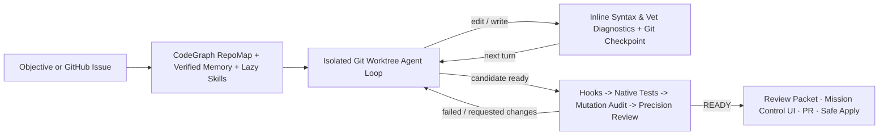

# Fabric

**Fabric** is a production-grade, repository-bound autonomous software engineering runtime in Go (with optional Rust repository intelligence).

Instead of trusting an unconstrained chat loop with raw shell access, Fabric wraps any coding model (Claude, GPT/Codex, OpenCode, Ollama, vLLM, or ACP agents) inside **deterministic engineering controls**: isolated Git worktrees, a local Code Knowledge Graph, inline post-edit diagnostics, lightweight checkpoint rewind, hard USD/token circuit breakers, diff-scoped mutation auditing, and a human-ready **Structured Review Packet**.

---

## How Fabric Works



---

## 30-Second Quickstart

Build the native binaries (`Go 1.27+`, optional Rust `cargo` for `fabric-ri`):

```powershell
go build -trimpath -o bin/fabric.exe ./cmd/fabric
cargo build --release --bin fabric-ri   # optional Rust index
```

Run in any committed Git repository:

```powershell
# 1. Auto-detect installed runtime (Claude Code, Anthropic/OpenAI API key, Codex) & test runner
fabric init --auto
fabric doctor --human

# 2. Launch the isolated agentic loop with a $1.50 cap and diff-scoped mutation audit
fabric agent --max-usd 1.50 --mutate "Fix timeout race condition and add regression tests"

# 3. Inspect the Structured Review Packet, rewind if needed, or apply cleanly to a branch
fabric packet
fabric apply --dry-run
fabric apply --branch fabric/fix-timeout

# 4. Open Mission Control Web UI + HTTP/SSE API + OpenAPI 3.1
fabric serve --addr 127.0.0.1:7420
```

---

## Core Capabilities

| Capability | Command / Surface | What It Does |
| --- | --- | --- |
| **Production Agentic Loop** | `fabric agent [--resume ID]` | Isolated worktree loop with Epoch Observation Masking (`arXiv:2508.21433`), inline edit diagnostics, turn-by-turn durable resume, live steering, and CapScope capability enforcement (`arXiv:2609.08371`). |
| **Cross-Model Tournaments** | `fabric tournament --models ...` | Runs parallel isolated contenders and selects the Pareto-optimal winner (`READY` -> mutation kill % -> minimal diff churn -> lowest USD spend). |
| **Code Knowledge Graph** | `fabric graph [--impact SYM]` | Zero-dependency Go AST + TS/JS/Py/Rust + Markdown knowledge graph with PageRank hub centrality (`repo_map`) and multi-hop blast radius (`graph_impact`). |
| **Instant Rewind & Safe Apply** | `fabric rewind` / `fabric apply` | Automatic Git snapshot refs before every edit + dry-run validated patch apply (including new untracked files) without dirtying `.git/index`. |
| **Mutation & Review Gates** | `fabric mutate` / `--review` | Diff-scoped mutation testing on production code only + fresh-context Alibaba OpenCodeReview filter-only precision review. |
| **Cost & Sandbox Guardrails** | `[budget]` / `[sandbox]` | Hard `max_usd` / `max_tokens` / `max_turns` breakers, secret-scrubbed subprocess env, OS process-tree kill, and hardened Docker/Podman isolation (`--network=none`, `--cap-drop=ALL`). |
| **Project Memory & 32 Embedded Skills** | `fabric memory` / `fabric skills` / `.agents/skills/` | Persistent verified lessons (`.harness/memory/lessons.jsonl`) + 32 built-in lazy SWE skills (architecture, brownfield matching, code hygiene, clean control flow, concurrency, TDD, review) embedded into the binary and installable into any repo. |
| **GitHub, Jira, Linear & GitLab** | `fabric ticket` / `issue` / `pr` / `review-pr` / `notify` / `bench` | Run isolated agents from Jira/Linear/GitLab/GitHub tickets, comment/transition back, open PRs with Review Packets, alert Slack/Discord/Teams/webhooks, and run empirical `bench` suites. |
| **Mission Control, API, SDK & MCP** | `fabric serve` / `fabric mcp` / `pkg/fabric` | Embedded CSP-strict Web Kanban + live SSE streaming + signed inbound webhooks + OpenAPI 3.1, 17-tool stdio MCP server, and public Go SDK. |

---

## Documentation for Humans

Start with the guide matched to what you want to do right now:

1. **[5-Minute Quickstart](docs/guides/quickstart.md)** — Install, initialize, run your first task, and apply the verified patch.
2. **[Production Agent Runtime Guide](docs/guides/production-agent-runtime.md)** — Full daily-driver handbook (`agent`, `tournament`, `graph`, `memory`, `issue`/`pr`, `bench`, `fabric.toml`).
3. **[Engineering Integrations Guide](docs/guides/integrations.md)** — Connect Jira Cloud/DC, Linear, GitLab, GitHub, Slack, Discord, Teams, and signed webhooks.
4. **[Mission Control UI, REST/SSE API & MCP Guide](docs/guides/api-and-mcp.md)** — Web UI workflows, `curl`/SSE/OpenAPI 3.1 examples, Claude/Codex/Cursor MCP setup, and Go SDK usage.
4. **[Documentation Hub](docs/README.md)** — Progressive map from architecture and security boundaries to v1 classic internals and research provenance.
5. **[Harness Engineering & Donor Research](docs/research/harness-best-practices-2026.md)** — 2025–2026 arXiv findings and donor mechanisms integrated into Fabric.
6. **[Contributing](CONTRIBUTING.md)** & **[CLI Reference](docs/reference/cli.md)**.
