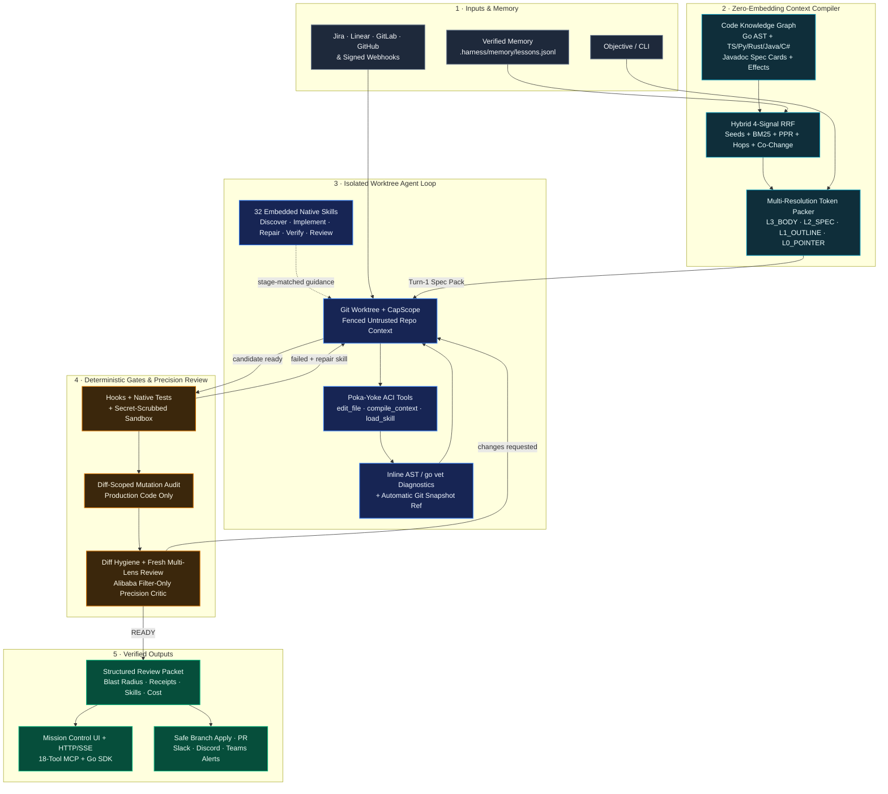
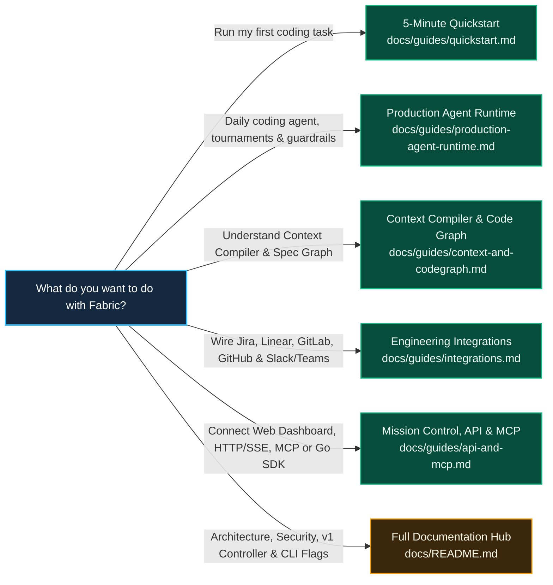

# Fabric

**Fabric** is a production-grade, repository-bound autonomous software engineering runtime in Go (with optional Rust repository intelligence).

Instead of trusting an unconstrained chat loop with raw shell access, Fabric wraps any coding model (Claude, GPT/Codex, OpenCode, Ollama, vLLM, or ACP agents) inside **deterministic engineering controls**: isolated Git worktrees, a zero-embedding **Javadoc Spec & Code Knowledge Graph**, a multi-resolution **Context Compiler**, inline post-edit diagnostics, lightweight checkpoint rewind, hard USD/token circuit breakers, diff-scoped mutation auditing, stage-aware native SWE skills, and a human-ready **Structured Review Packet**.

---

## How Fabric Works



---

## Navigate Fabric in 10 Seconds



### What's New in `v2.0.1`

- **Zero-Embedding Multi-Resolution Context Compiler (`fabric context` / `compile_context` / `POST /v1/context` / `fabric_context`):** Deterministic 4-signal RRF (`SEED` + pure-Go stopword-filtered `BM25` + `PersonalizedRank` + `--hops` BFS + bounded Git co-change), packed into `L3_BODY -> L2_SPEC -> L1_OUTLINE -> L0_POINTER` tiers with SHA-256 caching (`.harness/cache/context/graph-v1.json`) and KV-cache-invariant Markdown output.
- **Function-Level Javadoc Spec & Call/Type/Test Graph (`fabric graph --spec` / `GET /v1/graph/spec`):** Extracts Javadoc/JSDoc `@param`, `@returns`, `@throws`, `@see`, `@deprecated`, GoDoc, Python Google/Sphinx, and Rustdoc specs alongside behavioral `@effects` (`returns_error`, `uses_locks`, `spawns_async`, `io_http`, `io_exec`, ...) and typed `CALLS`, `USES_TYPE`, `TESTS`, `DOCUMENTS`, `REFERENCES` edges across Go AST, TS/JS, Python, Rust, Java, and C#.
- **Native Stage-Aware Skill Lifecycle + Default Precision Code Review:** Turn-1 skill selection, failure-triggered `repair`/`systematic-debugging`, pre-completion diff hygiene checks, and default multi-lens precision review (`--review=true`) recorded into `ReviewPacket.skills_used` and `hygiene_notes`.

---

## 30-Second Quickstart

Build the native binaries (`Go 1.27+`, optional Rust `cargo` for `fabric-ri`):

```powershell
go build -trimpath -o bin/fabric.exe ./cmd/fabric
cargo build --release --bin fabric-ri   # optional Rust index
```

Run in any committed Git repository:

```powershell
# 1. Auto-detect installed runtime (Claude Code, Anthropic/OpenAI API key, Codex) & test runner
fabric init --auto
fabric doctor --human

# 2. Compile a zero-embedding Spec Pack or inspect function contracts & blast radius
fabric context --spec-only "Fix timeout race condition"
fabric graph --spec VerifyHMACSHA256

# 3. Launch the isolated agentic loop with a $1.50 cap and diff-scoped mutation audit
fabric agent --max-usd 1.50 --mutate "Fix timeout race condition and add regression tests"

# 4. Inspect the Structured Review Packet, rewind if needed, or apply cleanly to a branch
fabric packet
fabric apply --dry-run
fabric apply --branch fabric/fix-timeout

# 5. Open Mission Control Web UI + HTTP/SSE API + OpenAPI 3.1
fabric serve --addr 127.0.0.1:7420
```

---

## Core Capabilities

| Capability | Command / Surface | What It Does |
| --- | --- | --- |
| **Production Agentic Loop** | `fabric agent [--resume ID]` | Isolated worktree loop with Epoch Observation Masking (`arXiv:2508.21433`), inline edit diagnostics, turn-by-turn durable resume, live steering, and CapScope capability enforcement (`arXiv:2609.08371`). |
| **Zero-Embedding Context Compiler** | `fabric context` / `compile_context` | 4-signal hybrid RRF (`SEED` + `BM25` + `PersonalizedRank` + `--hops` BFS + Git co-change), SHA-256 graph cache, nested `AGENTS.md` discovery, `UntestedSymbols`, and `L3 -> L0` budget packing. |
| **Javadoc Spec & Knowledge Graph** | `fabric graph --spec` / `--impact` | Function-level `SymbolSpec` cards (`@param`/`@returns`/`@throws`/`@effects`), Go AST `CALLS`/`USES_TYPE`/`TESTS`/`DOCUMENTS` edges, and multi-hop blast radius. |
| **32 Stage-Aware Native Skills** | `fabric skills` / `.agents/skills/` | Embedded SWE skills activated automatically across `discover -> implement -> repair -> verify -> review` + default multi-lens precision review (`--review=true`). |
| **Cross-Model Tournaments** | `fabric tournament --models ...` | Runs parallel isolated contenders and selects the Pareto-optimal winner (`READY` -> mutation kill % -> minimal diff churn -> lowest USD spend). |
| **Instant Rewind & Safe Apply** | `fabric rewind` / `fabric apply` | Automatic Git snapshot refs before every edit + dry-run validated patch apply (including new untracked files) without dirtying `.git/index`. |
| **Mutation & Budget Guardrails** | `fabric mutate` / `[budget]` / `[sandbox]` | Diff-scoped mutation audit on production code, hard `max_usd` / `max_tokens` circuit breakers, scrubbed subprocess env, and hardened Docker/Podman isolation. |
| **GitHub, Jira, Linear & GitLab** | `fabric ticket` / `issue` / `pr` / `notify` / `bench` | Run isolated agents from Jira/Linear/GitLab/GitHub tickets, comment/transition back, open PRs with Review Packets, alert Slack/Discord/Teams/webhooks, and run empirical `bench` suites. |
| **Mission Control, API, SDK & MCP** | `fabric serve` / `fabric mcp` / `pkg/fabric` | Embedded CSP-strict Web Kanban + live SSE streaming + signed inbound webhooks + OpenAPI 3.1, 18-tool stdio MCP server (`fabric_context` included), and public Go SDK. |

---

## Documentation for Humans

Start with the guide matched to what you want to do right now:

1. **[5-Minute Quickstart](docs/guides/quickstart.md)** — Install, initialize, run your first task, and apply the verified patch.
2. **[Context Compiler, Spec Graph & Skill Lifecycle](docs/guides/context-and-codegraph.md)** — Visual walkthrough of Fabric's zero-embedding ranking, Javadoc Spec Cards, multi-resolution packing, and native skill stages.
3. **[Production Agent Runtime Guide](docs/guides/production-agent-runtime.md)** — Full daily-driver handbook (`agent`, `tournament`, `graph`, `context`, `memory`, `skills`, `issue`/`pr`, `bench`, `fabric.toml`).
4. **[Engineering Integrations Guide](docs/guides/integrations.md)** — Connect Jira Cloud/DC, Linear, GitLab, GitHub, Slack, Discord, Teams, and HMAC-signed webhooks.
5. **[Mission Control UI, REST/SSE API & MCP Guide](docs/guides/api-and-mcp.md)** — Web UI workflows, `curl`/SSE/OpenAPI 3.1 examples, Claude/Codex/Cursor 18-tool MCP setup, and Go SDK usage.
6. **[Documentation Hub](docs/README.md)** — Complete visual sitemap, Go/Rust repository code map, architecture/security boundaries, v1 classic internals, and CLI reference.
7. **[Harness Engineering & Donor Research](docs/research/harness-best-practices-2026.md)** — 2025–2026 arXiv findings and donor mechanisms shipped in Fabric.
8. **[Contributing](CONTRIBUTING.md)** & **[CLI Reference](docs/reference/cli.md)**.
