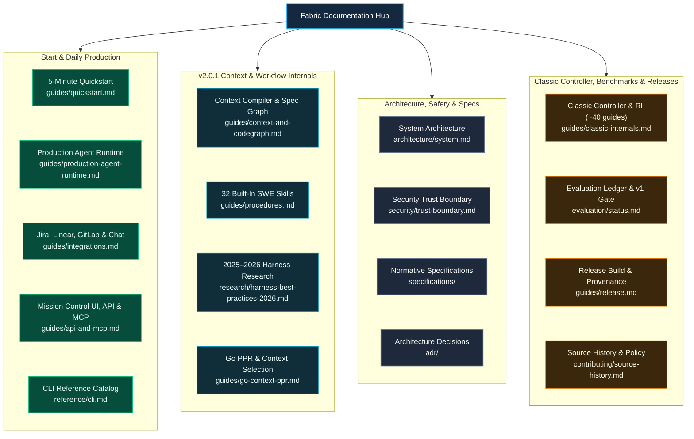
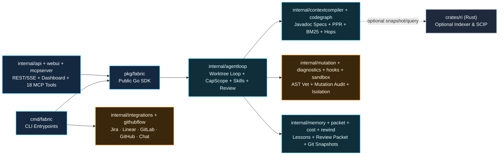

# Fabric Documentation Hub

Visual sitemap, code ownership map, and task-oriented navigation for the entire Fabric repository.

---

## Visual Documentation Sitemap

---

## Find By Question

| I want to... | Best Guide | Primary Command / Endpoint |
| --- | --- | --- |
| **Build & run my first coding task in 5 minutes** | [5-Minute Quickstart](guides/quickstart.md) | `fabric init --auto` -> `fabric agent` |
| **Understand zero-embedding Context Packs & Javadoc Spec Cards** | [Context Compiler & Spec Graph](guides/context-and-codegraph.md) | `fabric context --spec-only` / `fabric graph --spec` |
| **Configure budgets, Docker sandboxes, tournaments & hooks** | [Production Agent Runtime](guides/production-agent-runtime.md) | `fabric.toml`, `fabric tournament`, `fabric mutate` |
| **Browse or override the 32 native workflow skills** | [Engineering Skills Catalog](guides/procedures.md) | `fabric skills list` / `fabric skills install` |
| **Run agents directly from Jira, Linear, GitLab, GitHub or Slack** | [Engineering Integrations](guides/integrations.md) | `fabric ticket`, `fabric notify`, `POST /v1/webhooks/{provider}` |
| **Use the Web Kanban UI, REST/SSE API, MCP or Go SDK** | [Mission Control, API & MCP](guides/api-and-mcp.md) | `fabric serve`, `fabric mcp`, `GET /v1/openapi.json` |
| **Inspect trust boundaries, secret scrubbing & write isolation** | [Security Trust Boundary](security/trust-boundary.md) | `internal/agentloop/capabilities.go` + `internal/sandbox` |
| **Build reproducible release archives & verify hashes** | [Release Guide](guides/release.md) | `scripts/release-build.ps1`, `scripts/release-verify.ps1` |
| **Read v1 classic task-graph controller & Rust RI docs** | [Classic Controller & RI Guides](guides/classic-internals.md) | `fabric run --autonomous`, `fabric ri ...` |

---

## Repository Code Map (Go + Rust)

| Package / Crate | Responsibility |
| --- | --- |
| [`cmd/fabric`](../cmd/fabric) | Unified CLI dispatcher (`agent`, `context`, `graph`, `tournament`, `packet`, `rewind`, `mutate`, `apply`, `ticket`, `issue`, `pr`, `serve`, `mcp`, `bench`, `skills`) + classic controller routes. |
| [`internal/contextcompiler`](../internal/contextcompiler) | Zero-embedding Context Pack compiler: SHA-256 cache, `BM25` + `PersonalizedRank` + `--hops` BFS + Git co-change fusion, `L3->L0` budget packing, nested `AGENTS.md`, `UntestedSymbols`, skill affinity. |
| [`internal/codegraph`](../internal/codegraph) | Multi-language Code Knowledge Graph + `SymbolSpec` extractor (Javadoc/JSDoc/GoDoc/Python/Rust tags + static `@effects`), `CALLS`/`USES_TYPE`/`TESTS`/`DOCUMENTS` edges, `PersonalizedRank`, `Impact`. |
| [`internal/agentloop`](../internal/agentloop) | Worktree-isolated coding loop, Turn-1 Context Compiler injection, CapScope enforcement, Epoch Observation Masking, inline edit diagnostics, stage-aware skill activations, diff hygiene & precision review. |
| [`internal/api`](../internal/api), [`internal/webui`](../internal/webui), [`internal/mcpserver`](../internal/mcpserver) | Strict-CSP Mission Control Web UI, OpenAPI 3.1 HTTP/SSE server, fail-closed HMAC inbound webhooks, and 18-tool stdio MCP server. |
| [`internal/integrations`](../internal/integrations), [`internal/githubflow`](../internal/githubflow) | Leaf integration adapters for Jira Cloud/DC, Linear, GitLab, GitHub (`gh`), Slack, Discord, Microsoft Teams, and signed outbound webhooks. |
| [`internal/packet`](../internal/packet), [`internal/mutation`](../internal/mutation), [`internal/rewind`](../internal/rewind), [`internal/memory`](../internal/memory) | Structured Review Packets (`skills_used`, `hygiene_notes`), diff-scoped mutation audits, lightweight Git snapshot refs, and `.harness/memory/lessons.jsonl`. |
| [`pkg/fabric`](../pkg/fabric) | Public embeddable Go client SDK wrapping episode orchestration, graph/context queries, and safe apply. |
| [`crates/ri`](../crates/ri) | Optional Rust repository-intelligence indexer and SCIP/lexical sidecar (`fabric-ri`). |

---

## Core Architecture & Research Index

- **[System Architecture](architecture/system.md)** — Control flow, write-ownership isolation, verification gates, and evidence boundaries.
- **[Security Trust Boundary](security/trust-boundary.md)** — Isolation guarantees, secret scrubbing, CapScope enforcement, and known limits.
- **[Normative Specifications](specifications/)** & **[Architecture Decision Records (ADRs)](adr/)** — Authority, journal effects, and RI boundaries.
- **[2025–2026 Harness Research & Donors](research/harness-best-practices-2026.md)** — Empirical arXiv findings and donor mechanisms shipped in Fabric.
- **[Research Provenance](research/oss-mechanisms.md)** & **[v2 Product Roadmap](roadmap/v2-product-plan.md)**.

## Classic Controller Internals & Historical Archives

- **[Classic Controller, Provider & RI Guides](guides/classic-internals.md)** — All ~40 deep-dive guides for the deterministic v1 task-graph controller (`fabric run --autonomous`), `fabric-ri`, Codex confinement, and OpenCode/Responses protocols.
- **Getting Started Records (v1 history):** [Windows installed-task guide](getting-started/installed-autonomous-task.md) · [Local plan route](getting-started/local-plan.md) · [Real-task record](getting-started/real-task.md)
- **Evaluations & Releases:** [Release guide](guides/release.md) · [Evaluation status ledger](evaluation/status.md) · [v1 product gate](development/v1-product-gate.md) · [v1.0.0 release acceptance](evaluation/v1-release-acceptance.md) · [Real-repo eval harness](../evals/v1/README.md)
- **CLI & Contributing:** [CLI Reference](reference/cli.md) · [Codex integration](../integrations/codex/fabric/README.md) · [Contributing](../CONTRIBUTING.md) · [Documentation standard](contributing/documentation-standard.md) · [Source history policy](contributing/source-history.md)

## Evidence Vocabulary

Fabric separates implemented behavior from pinned run/package evidence using **PASS**, **FAIL**, **NOT RUN**, **BLOCKED**, and **UNKNOWN**. Missing timing, usage, or provider telemetry is recorded as unavailable — never zero.
