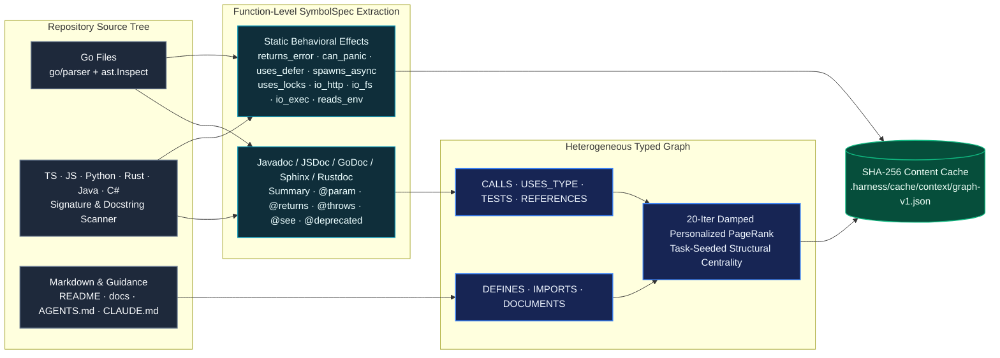
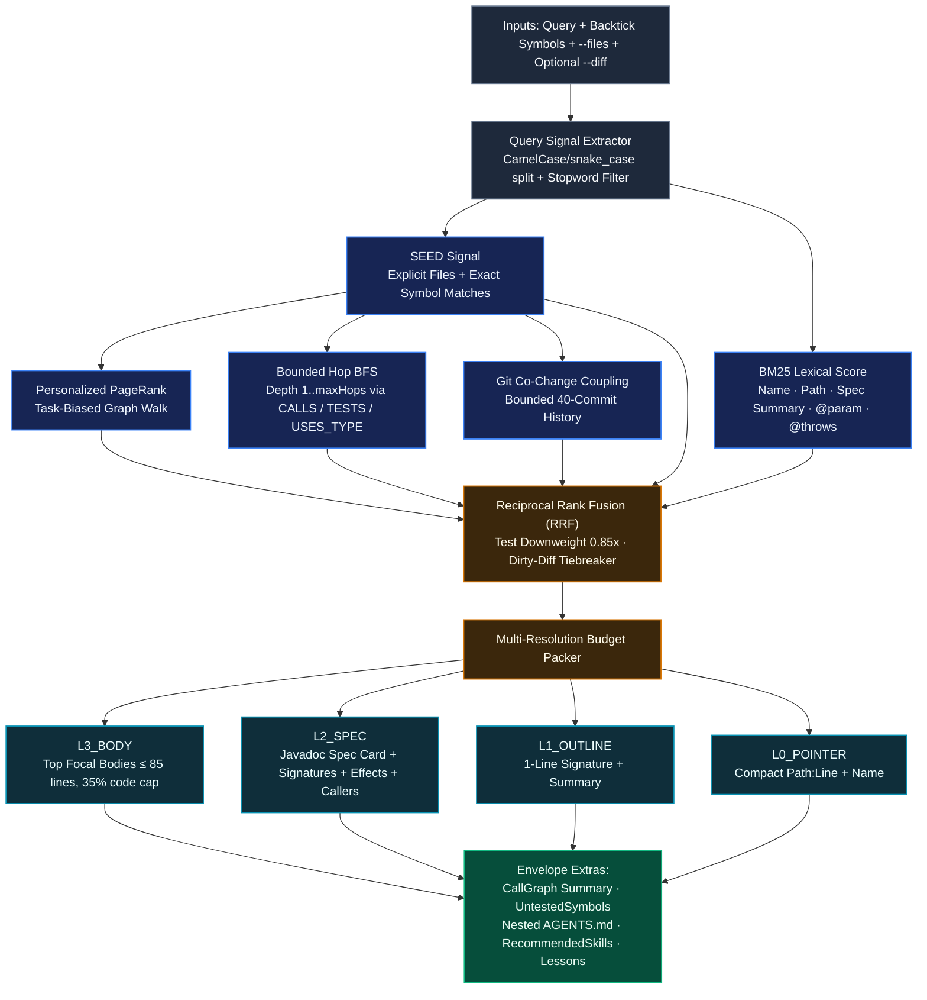
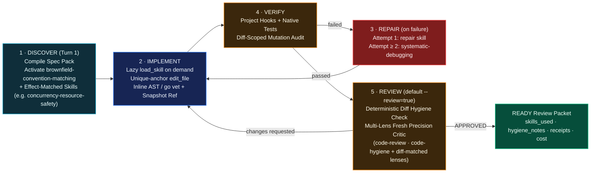

# Zero-Embedding Context Compiler, Javadoc Spec Graph & Native Skill Workflow

Fabric `v2.0.1` replaces blind whole-file stuffing and fragile vector databases with a **deterministic, zero-embedding Context Compiler** built directly on a **function-level Javadoc Spec & Call/Type/Test Knowledge Graph**, paired with a **stage-aware SWE skill lifecycle** ending in default precision code review.

---

## Why Zero Embeddings?

| Property | Vector Embedding RAG | Fabric `v2.0.1` Context Compiler |
| --- | --- | --- |
| **External infrastructure** | Requires embedding model API / vector store | Zero external services; pure local Go (`<2s` cold build) |
| **Freshness after edits** | Re-embedding lag or stale vector chunks | SHA-256 content-addressed cache (`.harness/cache/context/graph-v1.json`) invalidates instantaneously on any file byte change |
| **KV-Cache stability** | Semantic float drift reorders prompt prefixes | Sorted node/edge IDs + zero timestamps keep Turn-1 Markdown byte-identical |
| **Structural precision** | Fuzzy cosine similarity drops callers/callees/types | Exact AST `CALLS`, `USES_TYPE`, `TESTS`, `DOCUMENTS`, and `REFERENCES` edges with `EXTRACTED` vs `INFERRED` provenance |
| **Contract density** | Dumps raw chunks or loses signatures | Structured `SymbolSpec` cards (`@param`, `@returns`, `@throws`, `@effects`, callers, tests) preserve contracts at ~10x fewer tokens |

---

## 1. Code Knowledge Graph & Javadoc Spec Extraction

`internal/codegraph` parses Go source with `go/parser` + full `ast.Inspect` (including comments) alongside structural symbol/spec extraction for TypeScript, JavaScript, Python, Rust, Java, C#, and Markdown docs:



Inspect any symbol's contract card directly:

```powershell
fabric graph --spec VerifyHMACSHA256
fabric graph --impact internal/integrations/webhook.go --depth 2
```

---

## 2. 4-Signal Hybrid Ranking & Multi-Resolution Packing

`internal/contextcompiler` fuses query/symbol seeds, identifier-aware BM25, Personalized PageRank, bounded BFS `--hops` expansion, and Git co-change history via Reciprocal Rank Fusion (RRF), then packs results hierarchically under a strict token budget:



Compile packs from the CLI, HTTP API, or MCP:

```powershell
# Lean Javadoc Spec Cards + Call Graph (Turn-1 default for fabric agent)
fabric context --spec-only --budget 2500 "Verify webhook HMAC signatures"

# Full focal bodies (L3_BODY) for top hits anchored to explicit files
fabric context --files internal/integrations/webhook.go --hops 3 "ParseInboundWebhook"

# Include current working-tree git diff as gentle seed tie-breakers (or auto-seed when query is empty)
fabric context --diff "Check retry loop"
fabric context
```

> Notice that passing a query without `--diff` prevents unrelated dirty working-tree files from crowding out query-exact symbols. Omitting both query and `--files` automatically activates `--diff`.

---

## 3. Stage-Aware Native Skill Workflow & Precision Review

Fabric wires its **32 embedded SWE skills** ([Skill Catalog](procedures.md)) natively across all five phases of `internal/agentloop`, rather than dumping thousands of lines into Turn 1:



- **Effect-Matched Skill Routing:** If focal functions exhibit `uses_locks` / `spawns_async`, Fabric boosts `concurrency-resource-safety`; if `UntestedSymbols` are detected, `tdd` and `property-differential-testing` rise to the top; `io_exec` / auth terms elevate `security-audit` and `ci-and-supply-chain-hygiene`.
- **Diff-Matched Precision Review Lenses:** Before accepting `READY`, `auditDiffHygiene` checks for added `fmt.Println` / `console.log`, unresolved `TODO`/`FIXME`, un-tested production edits, and whitespace/conflict markers, while `composeReviewRubric` attaches targeted security, concurrency, or contract-migration lenses alongside `code-review` and `code-hygiene`.

---

## 4. API & MCP Endpoints

- **HTTP REST API:**
  - `GET /v1/graph/spec?target=VerifyHMACSHA256`
  - `POST /v1/context` with `{"query":"...", "files":["..."], "budget_tokens":3200, "hops":2, "spec_only":true, "include_diff":false}`
- **Stdio MCP Server:** `fabric_context`, `fabric_graph`, and `fabric_graph_impact`.

See [Production Agent Runtime Guide](production-agent-runtime.md), [API & MCP Guide](api-and-mcp.md), and [Documentation Hub](../README.md).
