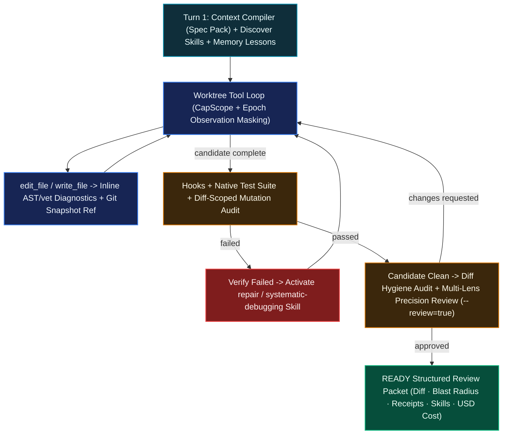

# Production Agent Runtime Guide

Fabric ships a complete, first-principles autonomous software engineering
runtime built for daily production work across any language, any model
provider, and any Git repository.



See [Context Compiler & Spec Graph Deep Dive](context-and-codegraph.md) for ranking internals and skill routing details.

## 1. Zero-Friction Initialization

```powershell
# Auto-detect Claude Code CLI, Anthropic/OpenAI API keys, Codex, and project tests
fabric init --auto

# Or choose a specific runtime explicitly:
fabric init --claude
fabric init --api anthropic --model claude-sonnet-4-5
fabric init --api openai --model gpt-5
fabric init --api openai --base-url http://127.0.0.1:11434/v1 --model qwen2.5-coder:32b
fabric init --acp /path/to/acp-agent

# Verify runtimes, hooks, budget, sandbox, and checks
fabric doctor --human
```

`fabric.toml` is the primary configuration file (`harness.toml` remains supported
for backward compatibility).

## 2. Production Agentic Loop (`fabric agent`)

`fabric agent` runs a bounded multi-turn coding loop inside an isolated Git
worktree with:

- **CapScope Typed Capabilities (`arXiv:2609.08371`):** tool permissions and
  write ownership are enforced outside the LLM context window; repo `AGENTS.md`,
  `CLAUDE.md`, lessons, and skills are fenced in `<untrusted_repo_context>` tags.
- **Poka-yoke ACI Toolbelt + Inline Diagnostics:** `compile_context`, `repo_map`,
  `graph_impact`, `list_skills`, `load_skill`, `read_file`, CRLF-aware unique-anchor
  `edit_file`, `write_file`, `delete_file`, `list_files`, binary-safe
  `search_text`, complete `git_diff` (including untracked files), and
  secret-scrubbed argv-only `run_command`. `edit_file`/`write_file` run instant
  inline syntax/vet checks (Go AST/`go vet`, JSON, Python `py_compile`, `tsc`).
- **Stage-Aware Native Skill Lifecycle + End-of-Loop Code Review:** Turn 1
  compiles a zero-embedding Javadoc/AST Spec Pack and activates relevant
  discovery skills automatically; test/hook failures activate `repair` /
  `systematic-debugging`; completion runs deterministic diff hygiene checks +
  multi-skill fresh-context precision review by default (`--review=false` opts out),
  recording `skills_used` inside the Review Packet.
- **Cache-Stable Epoch Observation Masking (`arXiv:2508.21433`):** advances the
  masking cutoff in epochs alongside multi-turn Anthropic ephemeral cache
  breakpoints so prompt cache prefixes remain hot across long runs.
- **Automatic Lightweight Checkpoints & Turn-by-Turn Resume:** saves pre-edit
  `refs/fabric/snapshots/<runID>/<step>` snapshots and full turn state so any
  interrupted/budget-capped episode can resume cleanly (`fabric agent --resume`).
- **Live Mid-Run Steering:** queue real-time operator instructions into an active
  episode via Mission Control or `POST /v1/episodes/{id}/steer`.

```powershell
# Isolated agent run with hard $1.50 cap and diff-scoped mutation audit
fabric agent --max-usd 1.50 --mutate "Fix edge-case timeout handling and add regression tests"

# Resume a budget-stopped or interrupted episode (short ID prefix works)
fabric agent --resume a3f9c12e --max-usd 3.50 --max-turns 32

# High-assurance run with fresh precision reviewer and hardened Docker sandbox
fabric agent --max-usd 3.00 --mutate --review --sandbox docker --sandbox-image golang:1.27 \
  "Implement rate limiter token bucket with unit tests"
```

## 3. Cross-Model Patch Tournaments (`fabric tournament`)

Launch parallel isolated contenders across models (or independent trajectories)
and select the Pareto-optimal winner (**READY -> non-empty patch -> highest
mutation kill score -> minimal diff churn -> fewest changed files -> lowest USD
cost**):

```powershell
fabric tournament --models claude-sonnet-4-5,gpt-5 --mutate \
  "Fix race condition in connection pool shutdown"
```

## 4. Code Knowledge Graph & Context Compiler (`fabric graph` & `fabric context`)

Zero-embedding local Code Knowledge Graph (`go/parser` AST + TS/JS/Py/Rust/Java/C#
symbols + Javadoc/GoDoc/docstring `@param`/`@returns`/`@throws`/`@effects` Spec Cards +
function-level `CALLS`/`USES_TYPE`/`TESTS`/`DOCUMENTS` edges + Personalized
PageRank) paired with `fabric context` (hybrid Seed + BM25 + PPR + Git
co-change fusion packed into `L3_BODY -> L2_SPEC -> L1_OUTLINE -> L0_POINTER`
tiers under strict token budgets and SHA-256 caching):

```powershell
fabric context --budget 3200 --spec-only "Fix Jira webhook HMAC validation"
fabric graph --spec VerifyHMACSHA256
fabric graph --save
fabric graph --impact internal/agentloop/loop.go --depth 2
```

## 5. Persistent Verified Project Memory (`fabric memory`)

Store compact, verified repository conventions under `.harness/memory/lessons.jsonl`
instead of bloating prompts with noisy chat history. Top relevant lessons are
automatically injected into Turn 1 of `fabric agent`:

```powershell
fabric memory add --scope "go/sqlite" "Always set _busy_timeout=5000 on SQLite connections"
fabric memory list
fabric memory rm <ID>
```

## 6. Review Packets, Rewind, Mutation Audit, Safe Apply & Cleanup

All episode commands accept Git-style short ID prefixes (e.g., `fabric apply a3f9`):

```powershell
fabric status --human                     # Unified table of episodes & classic runs
fabric packet [RUN_ID]                    # Structured Review Packet (Markdown or --json)
fabric rewind --list [RUN_ID]             # List worktree checkpoints
fabric rewind --to 1 [RUN_ID]             # Restore checkpoint #1
fabric mutate --max 12 -- go test ./...   # Diff-scoped mutation audit (production code only)
fabric apply --dry-run [RUN_ID]           # Check patch & clean repo without mutating
fabric apply --branch fabric/fix [RUN_ID] # Safely apply patch (includes untracked new files)
fabric clean --dry-run --keep 5           # Prune old worktrees while keeping episode packets
```

## 7. GitHub Issues, PRs & Precision PR Review (`gh` CLI)

```powershell
# Solve a GitHub issue directly in an isolated worktree
fabric issue --max-usd 2.00 --mutate 42

# Apply READY episode, commit, push, and open a PR with the Review Packet as body
fabric pr --branch fabric/fix-42

# Run Alibaba-style filter-only precision review on any open PR diff
fabric review-pr 42
```

## 8. Empirical Benchmark Harness (`fabric bench`)

Measure objective model/harness tradeoffs across a JSONL task suite (**Pass@1,
Mutation Kill %, Mean USD Cost, Cache Hit %, Diff Churn, Duration**):

```powershell
fabric bench --suite benchmarks.jsonl --model claude-sonnet-4-5 --mutate
```

## 9. `fabric.toml` Production Controls

```toml
[budget]
max_usd = 2.50
max_tokens = 250000
max_turns = 24
max_wall_seconds = 900

[sandbox]
mode = "docker"           # local | docker | podman
image = "golang:1.27"
allow_network = false
inherit_secrets = false   # strips API keys/tokens from subprocess env by default
memory_mb = 2048
cpus = "2"

[[hooks]]
name = "gofmt-check"
event = "post_write"
argv = ["gofmt", "-w", "."]
timeout_seconds = 30
on_failure = "block"
```

## 10. Lazily Loaded Engineering Skills (32 Embedded + Repo-Overridable Skills)

Every compiled `fabric` binary embeds **32 built-in SWE skills** (`fabric skills list`,
`fabric skills show <NAME>`, `fabric skills install [--root DIR]`) while allowing
any repository's `.agents/skills/<name>/SKILL.md` to override or extend them:

- **Discovery, Architecture & Integration:** `graph-navigation`, `context-hygiene`,
  `fault-localization`, `codebase-trace`, `blast-radius`, `architecture`,
  `modular-design-and-boundaries`, `brownfield-convention-matching`,
  `repo-onboarding-and-integration`, `api-and-interface-ergonomics`, `working-context`
- **Planning & Specs:** `spec-driven-dev`, `vertical-planning`,
  `requirement-analysis`, `decision-rationale`
- **Implementation & Code Craft:** `anchored-editing`, `clean-code-and-control-flow`,
  `error-handling-and-observability`, `structural-refactoring`, `repair`,
  `systematic-debugging`
- **Code Hygiene & Safety:** `code-hygiene`, `concurrency-resource-safety`,
  `safe-migrations-and-contracts`, `ci-and-supply-chain-hygiene`,
  `performance-and-profiling`
- **Testing & Audit:** `tdd`, `property-differential-testing`,
  `verification-before-completion`, `verification-design`, `code-review`,
  `security-audit`

See the [Engineering Skills Catalog](procedures.md) and
[API, Mission Control & MCP Guide](api-and-mcp.md).
